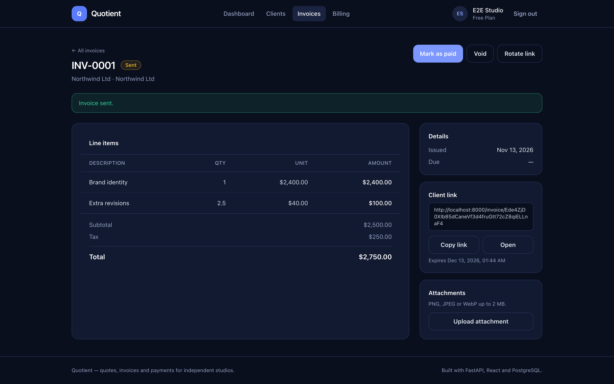
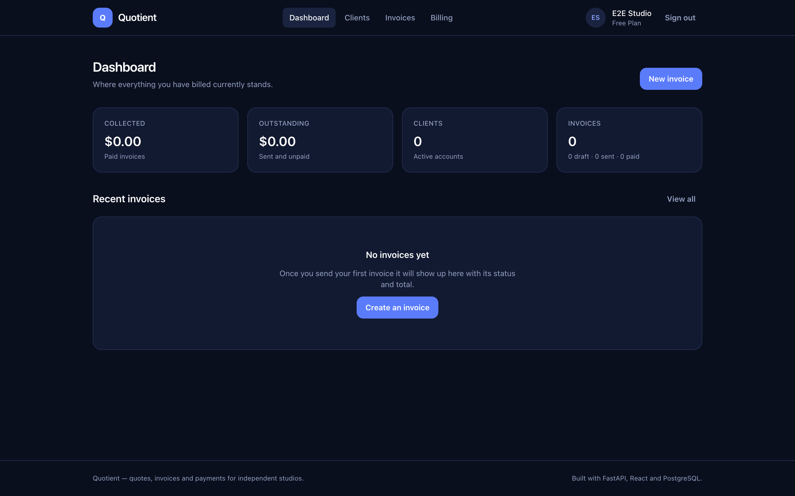
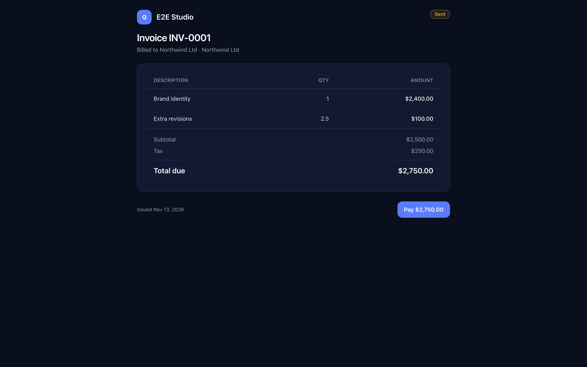
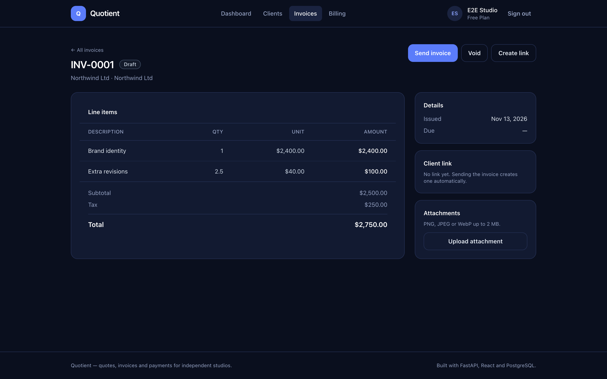

# Quotient

Quotes, invoices and payments for independent studios and freelancers.

Quotient is a small full-stack workspace where a freelancer can raise a quote,
turn it into an invoice, share a single link with the client and collect
payment — without the client ever creating an account.



---

## Why it exists

Most invoicing tools are either too heavy for a one-person studio or too loose
with the parts that actually matter: who can see an invoice, what a client is
charged, and whether a webhook was really signed. Quotient was built to be
small enough to read in an afternoon and strict enough to survive a security
review.

## Highlights

- **Server-authoritative totals.** Money is stored as integer cents and every
  total is recalculated from the line items on the server. Totals sent by the
  client are ignored, not trusted.
- **Share links with an expiry.** Sending an invoice mints a random, expiring
  token. Rotating it invalidates the previous link immediately.
- **Real role checks.** Every query is scoped to the owner, and the `/admin`
  surface requires the administrator role at the router, not in the UI.
- **Signed, idempotent webhooks.** Payment events are verified before they are
  applied and de-duplicated by event id, so a replayed delivery cannot double
  count.
- **Uploads that are checked by content.** File type is detected from magic
  bytes and compared with the declared type before anything is written to disk.
- **A sandbox payment provider.** The development provider signs its payloads
  with an HMAC and pushes them through the exact same verification path Stripe
  uses, so the flow is fully testable without an account.

| Clients | Public invoice | Billing |
| --- | --- | --- |
|  |  |  |

## Stack

| Layer | Choice |
| --- | --- |
| API | FastAPI, Pydantic v2, SQLAlchemy 2.0 |
| Auth | Argon2id password hashing, HS256 session tokens in `HttpOnly` cookies, double-submit CSRF |
| Data | SQLite for local development, PostgreSQL for production |
| Payments | Provider interface with a Stripe implementation and a signed sandbox implementation |
| Web client | React 19, TypeScript, Vite, Tailwind CSS v4, React Router |
| Tests | pytest + FastAPI `TestClient` (80 tests), Vitest (14 tests), Playwright walkthrough |
| Tooling | Ruff, ESLint, `tsc --noEmit`, GitHub Actions, Docker |

## Security model

| Concern | How it is handled |
| --- | --- |
| Secrets | Read from the environment only. `.env` is git-ignored, `.env.example` holds placeholders, and CI scans tracked files for credential patterns. |
| Admin routes | `require_admin` runs as a router-level dependency, so a non-administrator gets `403` before any handler code executes. |
| Authorisation | Every invoice, client, file and payment query is filtered by `owner_id`. Cross-account access returns `404`, not `403`, so IDs cannot be probed. |
| Database rules | Foreign keys are enforced, SQLite runs with `PRAGMA foreign_keys=ON`, and writes go through the ORM rather than string-built SQL. |
| Input validation | Every request body is a Pydantic model with explicit bounds. Quantities, tax and discount rates are range checked, and emails are parsed rather than pattern matched. |
| Rate limits | A sliding-window limiter guards authentication, public invoice links, uploads and checkout. Exceeding a limit returns `429` with `Retry-After`. |
| Uploads | Size limit, magic-byte sniffing, declared-type agreement, generated filenames and a path-traversal safe read path. |
| Errors | One JSON envelope for every failure, with a request id. Stack traces, SQL and internal exception text never reach the client. |
| Debug output | Structured logging with request ids. `uvicorn.access` is muted and no `print` calls remain in the source. |
| Sessions | Short-lived signed tokens in `HttpOnly`, `SameSite=Lax` cookies; `Secure` and HSTS are enabled in production. |
| CSRF | A double-submit token is cross-checked against the claim inside the signed session token on every mutating request. |
| Webhooks | Signature verification before parsing, replay protection by event id, and idempotent application of payment state. |
| Browser | A strict `Content-Security-Policy`, `nosniff`, `X-Frame-Options: DENY`, `Referrer-Policy` and `Permissions-Policy` on every response. |

## Getting started

### Local

```bash
git clone https://github.com/theanugrahh/quotient.git
cd quotient

cp .env.example .env      # then edit SECRET_KEY
make install

make backend              # http://localhost:8000
make frontend             # http://localhost:5173
```

The API is served at `http://localhost:8000/api` and the interactive docs at
`http://localhost:8000/docs`.

Promote an account to administrator:

```bash
make admin EMAIL=you@studio.com PASSWORD='a-strong-password'
```

### Docker

```bash
export SECRET_KEY=$(python3 -c "import secrets; print(secrets.token_urlsafe(48))")
docker compose up --build
```

The API, the built web client and PostgreSQL start together on
`http://localhost:8000`.

## How the money works

All amounts are integer cents. Quantities are thousandths of a unit, so a
charge for two and a half hours at $40.00 is stored as `2500 × 4000` and
rounded half-up to `10000` cents.

```
subtotal = Σ line_amount(item)
discount = round(subtotal × discount_bp / 10_000)
tax      = round((subtotal − discount) × tax_bp / 10_000)
total    = subtotal − discount + tax
```

`backend/app/money.py` holds these as pure functions, and they are covered by
unit tests that pin the rounding behaviour.

## API surface

| Method | Path | Notes |
| --- | --- | --- |
| `POST` | `/api/auth/register` | Creates an account and starts a session |
| `POST` | `/api/auth/login` | Sets the session cookie |
| `GET` | `/api/auth/session` | Current account or `null` |
| `POST` | `/api/auth/logout` | Clears the session |
| `GET` | `/api/clients` | Paged and searchable |
| `POST` | `/api/clients` | |
| `POST` | `/api/invoices` | Totals are calculated server side |
| `POST` | `/api/invoices/{id}/send` | Draft → sent, mints a share link |
| `POST` | `/api/invoices/{id}/mark-paid` | |
| `GET` | `/api/public/invoices/{token}` | No session required, rate limited |
| `POST` | `/api/files/upload` | Multipart, content verified |
| `POST` | `/api/billing/checkout` | Starts a checkout session |
| `POST` | `/api/webhooks/{provider}` | Signature verified, idempotent |
| `GET` | `/api/admin/users` | Administrator only |
| `GET` | `/api/admin/audit` | Administrator only |

The full schema is generated at `/openapi.json`.

## Payments

`app/payments` defines a small provider interface. Two implementations ship
with the project:

- `MockPaymentProvider` — signs payloads with HMAC-SHA256 and posts them
  through the same webhook endpoint Stripe uses. This is what runs in
  development and in the test suite.
- `StripePaymentProvider` — creates a real Checkout Session and verifies
  `stripe-signature` headers.

To switch, set `PAYMENTS_PROVIDER=stripe` and supply `STRIPE_SECRET_KEY`,
`STRIPE_WEBHOOK_SECRET` and `STRIPE_PRICE_ID`.

## Tests

```bash
make test                                   # both suites
cd backend && .venv/bin/pytest --cov=app    # API coverage
cd frontend && npm test                     # client unit tests
```

The backend suite covers authentication, authorisation between accounts, the
invoice lifecycle, CSRF, rate limiting, uploads, webhook signatures and
idempotency, plus the money arithmetic.

## Project layout

```
quotient/
├── backend/
│   ├── app/
│   │   ├── main.py          # app factory, middleware, routers
│   │   ├── config.py        # environment driven settings
│   │   ├── models.py        # SQLAlchemy models
│   │   ├── schemas.py       # Pydantic request and response models
│   │   ├── security.py      # hashing, tokens, CSRF
│   │   ├── rate_limit.py    # sliding window limiter
│   │   ├── storage.py       # upload validation and storage
│   │   ├── money.py         # pure money arithmetic
│   │   ├── payments/        # provider interface, stripe, sandbox
│   │   ├── services/        # invoice and payment domain logic
│   │   └── routers/         # HTTP surface
│   └── tests/
├── frontend/
│   └── src/
│       ├── api/             # typed client and models
│       ├── components/      # layout and UI primitives
│       ├── context/         # session handling
│       └── pages/           # routed screens
└── docs/screenshots/
```

## Notes and limitations

- The in-process rate limiter is per node. A multi-node deployment should back
  the same interface with Redis.
- Uploads are stored on the local filesystem. Object storage would be the
  natural next step.
- The sandbox payment provider is for development only. Production runs
  against Stripe.
- Email delivery for password resets is not implemented; the password change
  flow requires the current password.

## License

MIT
